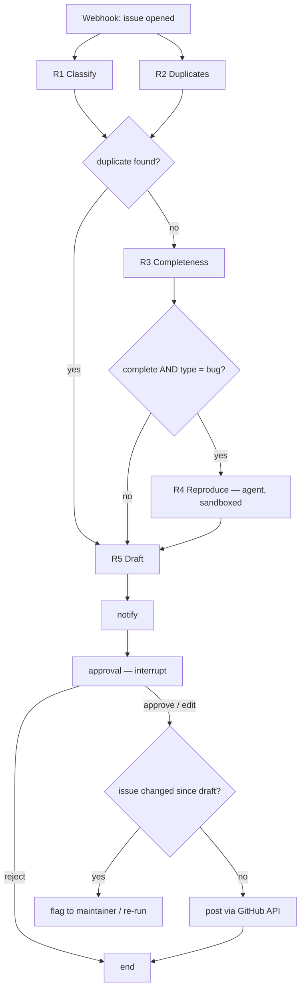

# GithubTriage — Design Notes

A running log of design decisions and *why* they were made.

---

## The method (use for every requirement)

1. **Map the manual process** — how does a human do it today?
2. **Dissect each step** — input, decision, output, cost of being wrong
3. **Pick the cheapest executor** — Rule → LLM call → Agent; does a Human need to sign off?
4. **Define the state** — what data flows between steps (Pydantic)
5. **Design the tools** — only for steps that must read/act on the outside world
6. **Wire the flow** — order, branches, parallelism, early exits, HITL
7. **Production lens** — failure modes, mitigations, eval metric

---

## 1. Manual process today

| # | Human step | Looks at | Output | Time |
|---|---|---|---|---|
| 1 | Classify type (bug / feature / question / docs) | Title, body | Type label | ~30s |
| 2 | Check for duplicates | Issue search, memory | "Duplicate of #N" or nothing | 1–5 min |
| 3 | Check completeness (version, repro, logs) | Body, template | "Please add X" or nothing | ~1 min |
| 4 | Try to reproduce | Local dev env | Confirmed / can't reproduce | 5–30 min |
| 5 | Judge severity + area | Codebase knowledge, report volume | Priority/area labels, assignee | ~1 min |
| 6 | Write a first reply | Docs, past issues | Comment | 2–5 min |

**Observations**
- Biggest time sinks: steps 2, 4, 6.
- Main output is a *comment + labels* → system produces a **draft** for maintainer approval.
- Flow has early exits (duplicate → stop; question → no reproduction). Paths depend on results, but the set of paths is small and known.

---

## 2. Per-requirement decisions

Template for each entry:

> **Input:** … **Decision:** … **Output:** … **Cost of error:** …
> **Executor:** Rule / LLM call / Agent / Human — *why*
> **Tools needed:** …
> **Production risks → mitigations:** …
> **Eval metric:** …

### R1. Classification
- **Input:** issue title + body. **Decision:** one of 4 fixed types (bug / feature / question / docs), or `unclear`. **Output:** type + confidence + short reasoning. **Cost of error:** low (human reviews), but a wrong type routes the issue down the wrong branch.
- **Executor:** ~~Rule if an issue template was used;~~ otherwise **one structured LLM call** (Pydantic `Literal` schema). *The template rule is contradicted by real data (slice 4 module 8, below): on pydantic, 23 of 25 sampled questions were filed with the bug or feature form. The form is the reporter's guess, not a fact; it stays at most an input signal, to be measured as a baseline.* Not an agent — nothing to look up, no step depends on an observation.
- **Tools needed:** none.
- **Production risks → mitigations:**
  - Ambiguous / mixed issues → allow `unclear`; **`unclear` always needs a human, regardless of confidence** (see findings below); low confidence on other types also routes to a human once calibrated
  - Overconfident model → calibrate confidence against eval set before using it in any rule. *Measured (module 12): not usable — ECE 0.336, same confidence right or wrong; rules use `unclear` only.*
  - Prompt injection in body → delimit issue as data; classification never triggers writes on its own; HITL
  - Malformed output → native structured output + 1 retry + fallback to `unclear`
  - Cost at scale → small/cheap model is sufficient
- **Eval metric:** accuracy / macro-F1 vs. maintainer labels on 50–100 closed issues. *Done in slice 4 (details below, from "Eval ground truth"):* 237 pydantic issues, dev 115 / test 122; reported as coverage + accuracy on answered, macro-F1, per class, and **kept-as-filed vs relabelled**. **Summary (dev, `classify-v1`):** 63.5% overall vs 41.1% "trust the form" and 25.2% "always bug"; **95.0% on issues kept as filed**, 29.1% on relabelled ones (construct validity — a known limit, option A); confidence unusable (ECE 0.336); abstention experiment failed (v2, v3). **Test split (measured once, 2026-11-21): 62.5% accuracy, macro-F1 60.0%, coverage 98.4%; 88.9% on issues kept as filed (63 answered of 65), 33.3% on relabelled; baselines 44.2% (form) / 25.4% (bug); ECE 0.342.** This is the number to quote.
- **Findings from the slice 1 sample run** (10 samples, 10/10 correct — a behaviour check, not an accuracy measure):
  - **Confidence is not yet usable for decisions.** Every sample scored 0.80–0.99, so a rule like "human review below 0.7" would almost never trigger. Calibrate on the slice 4 eval set first.
  - **`unclear` and low confidence are different signals.** `unclear_mixed.json` came back `unclear` at 0.93 — the model is *confident the issue is mixed*. **Decision:** any routing rule treats `type == "unclear"` as needing human attention **regardless of confidence**; confidence thresholds apply only to the other types.
- **Idea — not decided:** flag injection attempts to maintainers. The model correctly ignored the injection in `injection.json`, but its reasoning didn't mention it, so maintainers never learn someone tried to manipulate the bot. Option: add `suspicious_instructions: bool` to `Classification` and show a warning in the approval page. Trade-off: extra output tokens and a new field to evaluate (false alarms on issues that legitimately quote instructions, e.g. bug reports about prompts). Revisit when building the approval page (slice 3/7).
- **Model choice — provisional (2026-10-15):** `openai/gpt-oss-120b` with `GROQ_REASONING_EFFORT=low`. Alternative: `qwen/qwen3.8-27b` with effort `none`.
  - **How it was found:** a LangSmith trace showed one `docs.json` classification taking **55.3s**. The trace placed all the time in the `classify` LLM run; `-v` logs showed **client retries** (the main cause). The trace also showed **111 output tokens, 48 of them hidden reasoning** — ~43% of output spent "thinking" on a 5-way classification. That prompted a comparison.
  - **Experiment:** `debug_helper_scripts/run_samples.py` on the 10 samples, one run per configuration, switching settings via environment variables:

    | | A: gpt-oss-120b, default effort | B: gpt-oss-120b, low effort | C: qwen3.8-27b, effort none |
    |---|---|---|---|
    | Correct (incl. 2 adversarial) | 10/10 | 10/10 | 10/10 |
    | Median / max / total time | 5.3s / 12.9s / 69.5s | 3.1s / 4.9s / 36.1s | **2.3s / 4.1s / 25.3s** |
    | Confidence: `empty_body` / `unclear_mixed` | 0.85 / 0.93 | 0.60 / 0.85 | **0.30 / 0.40** |
    | Tokens on `docs.json` | 111 output (48 reasoning) | — | — |
    | Tokens on `unicode.json` (in / out) | — | 557 / 92 | 750 / 77 |
    | Groq price per 1M tokens (in / out) | $0.15 / $0.60 | $0.15 / $0.60 | $0.80 / $4.00 |
    | **Cost on `unicode.json`** (tokens × price) | — | **$0.000139** (~$0.14 per 1,000 issues) | $0.000908 (~$0.91 per 1,000 issues) |

  - **Why B:**
    - Same results as C on every sample, including both attacks.
    - **~6.5× cheaper than C.** The flow design (§4) says latency barely matters — a human approves hours later — **so cost wins.**
    - C's advantages don't matter yet: its 0.8s faster median isn't a constraint for background triage, and its more informative confidence isn't used until confidence is calibrated (slice 4).
    - Low reasoning effort halved latency vs the default (median 5.3s → 3.1s) with no loss on the samples.
  - **History:** the first version of this decision chose C, assuming the smaller non-reasoning model was also cheapest. Measured cost showed the opposite (C uses ~35% more tokens for the same text — a different tokenizer — and costs 5.3× more per input token and 6.7× more per output token). Reversed the same day. *Measure cost; don't infer it from model size.*
  - **Caveats:**
    - **Ceiling effect** — all three scored 10/10, so the samples can't separate the models on accuracy. The choice rests on cost, latency and confidence behaviour.
    - 10 samples, one run each; timings are noisy (rate limits, retries). Cost measured on one sample (`unicode.json`).
    - **Prices verified** against Groq's pricing page: tokens × price reproduces LangSmith's cost exactly ($0.0001568 for `docs.json` on default effort). An earlier "9×" came from dividing rounded dashboard values ($0.0009 / $0.0001); computed from raw numbers it is ~6.5×. *Calculate ratios from raw numbers, not rounded display values.*
    - Token counts are not comparable across models (different tokenizers) — compare cost in money.
    - C's coarse confidence (0.95 on 7 of 10 samples) also limits its value for thresholds.
  - **Revisit C if** calibrated confidence becomes important (slice 4). **Re-evaluate both** on the slice 4 eval set (real issues + more adversarial cases, e.g. a bug report titled "Question"). Switching is a `.env` change only.
- **Eval ground truth — pydantic/pydantic (slice 4 module 8, `evaluation/labels.py`, decided 2026-11-10):**
  - *Label map:* `bug V2` → bug (V2 only: V1-era issues describe a different codebase), `feature request` → feature, `question` → question, `documentation` → docs.
  - *Who applied a label matters.* pydantic's forms add labels automatically (`bug-v2.yml` → `bug V2` + `pending`; `feature_request.yml` → `feature request`; no question or docs forms), recorded in the issue events **as the reporter**. A form label is the reporter's guess; a maintainer's label is the judgement we want. `pending` = not triaged yet (a maintainer removes it). Use **who** (event actor), not **when**: template labels are recorded a second or so after creation.
  - *Trust rule:* **gold** = a maintainer (not the reporter, not a bot) applied the label, removed `pending`, or filed the issue (`author_association` OWNER / MEMBER / COLLABORATOR). **silver** = reporter-only (D2: kept, reported separately). **Excluded** = still `pending` (D1: unreviewed), several of our labels (D3: ambiguous), none of ours. **Relabelled** issues (a maintainer replaced the reporter's label) are kept and flagged: they are the hard cases, and dropping them would inflate the score.
  - *Event history must be complete* (`list_issue_events` raises `TruncatedError`): a missing page could hide a relabel.
  - *Live check, 25 recent closed issues per label (read-only):*

    | Label | Result |
    |---|---|
    | bug V2 | 21 gold · 4 excluded (still pending) |
    | feature request | **18 silver** · 5 gold · 2 gold relabelled |
    | question | **23 gold relabelled** · 1 gold · 1 excluded (question + documentation) |
    | documentation | 5 gold relabelled · 1 gold · 1 silver (only 7 issues on the first page — the rest were PRs) |

  - *What it means:*
    - Questions almost always arrive **disguised as bug reports or feature requests** — R1 must judge the content, not the chosen form (hence the struck-out template rule above).
    - **Most feature requests are unconfirmed** (silver): gold-only feature numbers will rest on few issues; report gold and silver separately.
    - **Docs issues are scarce** among issues (most `documentation` items are PRs): the backfill needs to page further for docs.
  - *`unclear` is an abstention, not an error* (D4: by design a human decides). The eval runner reports **coverage** (share of issues answered) next to **accuracy on answered issues**, so "always unclear" can't look perfect.
  - *Never an input to the model:* labels and event history are the answer key only (leakage).
  - *The reporter's form label* (`reporter_label`, their first label of ours) is stored for a **"trust the form" baseline** but is **never shown to the model** either. It isn't leakage (it exists at triage time), but it is reporter-controlled, and wrong for most questions: it would **anchor** the model on the reporter's mistake, and the baseline comparison would no longer be independent.
- **The eval set (slice 4 module 9, `evaluation/dataset.py`, `debug_helper_scripts/backfill_eval.py`, built 2026-11-10):**
  - *Selection (D1, D2):* closed issues **created** since 2024-01-01 (text written against the current codebase; listing is newest-created first, so paging stops at 2023), the newest **60 usable per label** — balanced, so per-class precision/recall is measurable for rare classes. Real per-type counts (search API) are stored in `evals/pydantic/frequencies.json` for a frequency-weighted accuracy: bug 1,112 · feature 274 · question 157 · docs 72.
  - *Storage (D3):* `evals/pydantic/manifest.jsonl` (committed: numbers + answer key, no text, no authors) and `DATA_DIR/eval/pydantic_issues.jsonl` (gitignored: titles + bodies — other people's writing, not ours to republish). `--rebuild` recreates the texts from the manifest.
  - *Resumable:* events are cached on disk (atomic writes) — the first real run died on a network drop and lost every request; closed issues' histories are settled, so the cache stays valid.
  - *Result — 237 issues:*

    | Type | Gold | Silver | Relabelled | "Trust the form" right |
    |---|---|---|---|---|
    | bug | 60 | 0 | 1 | 34/60 (25 had no form label) |
    | feature | 19 | 41 | 10 | 45/60 |
    | question | 60 | 0 | 56 | **0/60** |
    | docs | 50 | 7 | 45 | 6/57 (all usable since 2024) |

    Excluded: 24 bugs still `pending`; 16 issues with two of our labels (mostly docs + another).
  - *What the baseline says:* trusting the reporter's form gets **85/237 (36%)** and **no question at all** — the bar R1 has to clear, and the reason R1 exists. Issues with no form label give the baseline no answer (it abstains, like `unclear`).
  - *Frozen:* re-collecting later would pick a different "newest 60" and silently change what we measure on, so the backfill refuses to overwrite the manifest without `--force` (and then keeps the splits of issues still present).
  - *Caveats:* "newest 60" over-represents recent issues; features rest mostly on silver labels; docs has 57, not 60; issue bodies are fetched as they are **now** (possibly edited after triage).
- **Dev / test split (slice 4 module 10, `evaluation/split.py`, 2026-11-11):**
  - *Why:* tuning a prompt while watching the score **is** training — with my judgement as the optimiser — and fitting to the data it's scored on makes the number optimistic (plus picking the best of many configurations is biased upward by chance alone). **dev** = tune, compare, read individual errors; **test** = the final measurement only, never used for a decision.
  - *How:* **stratified** by (type, trust, relabelled), each group cut **exactly** in half (a plain `hash < 0.5` is only 50/50 on average — a 57-issue class can come out 22/35); within a group, ordered by **SHA-256 of `repo#number`** (fixed and effectively random; the API's newest-first order would make a hidden time split); an odd group's extra issue goes to test. **Frozen:** assigned issues never move — re-cutting a grown group would move the cut point and slide test issues into dev — new issues are split among themselves. Stored in the manifest (`split`), so git shows any change.
  - *Result:* **115 dev / 122 test** — e.g. relabelled questions 28/28, silver features 20/21, docs (all strata) 27/30.
  - *Access rule (enforced in module 11, not a promise):* the runner prints per-issue results for dev only; on test it prints summary numbers only and appends every run to a log (date, configuration, scores), so test-set reuse is visible.
  - *Later:* issues created after the backfill are a natural **drift check** (a time-based test), once the system is tuned.
- **Eval runner (slice 4 module 11, `evaluation/runner.py`, `evaluation/metrics.py`, `debug_helper_scripts/run_eval.py`, 2026-11-11):**
  - *The real constraint is throughput, not money.* Groq limits on this account: 30 requests and **8,000 tokens per minute**, 1,000 requests and **200,000 tokens per day**. Measured **~1,300–1,470 tokens per call** on real issues (the `unicode.json` sample suggested 557 — estimate from representative data) → **~5 calls/minute, ~140/day**; one full dev pass (115) uses most of a day. Cost is ~$0.26 per 1,000 issues.
  - *Decisions:* **1 run per configuration** (repeated runs would triple every evaluation; run-to-run variation to be measured once on a subset with `--runs 2` — runs are cached separately); **one call at a time, paced by a client-side token budget** (7,000/min, below the 8,000 limit — parallel calls would only become 429s); **failures reported separately, never scored**; complete test runs logged to `evals/pydantic/test_runs.jsonl`.
  - *Same code path as production:* the classify node was split into `classify_issue()` (one LLM call, **raises** on failure) and the node (falls back to `unclear`). The eval calls `classify_issue`, so it measures the production prompt — but a network error is not counted as the model choosing to abstain. Tokens come from LangChain's `UsageMetadataCallbackHandler`.
  - *Cache:* predictions keyed by **configuration** (`model__effort__prompt-version`), issue and run, in `DATA_DIR/eval/predictions/`. A run stopped by `--max-calls` or a rate limit resumes exactly where it stopped; re-scoring costs nothing; a configuration is never paid for twice; changing the prompt version can't mix old and new results.
  - *Order:* issues are processed in **hash order**, so a partial run (`--max-calls 40`) is a mixed **quick-dev sample**, not "the first 40 bugs" (the first smoke run, in manifest order, was 5/5 bugs).
  - *Baselines are scored on exactly the issues the model was scored on* — the first version compared the model on 5 issues with baselines on 115.
  - *Report:* coverage + accuracy on answered (D4), macro-F1, frequency-weighted accuracy, per-class coverage/precision/recall, gold / silver / relabelled breakdown, "always bug" and "trust the form" baselines, confusion matrix with abstentions, tokens, p50/p95 latency, cost. `--show-errors` (dev only) lists each misclassified issue; test prints summaries only.
- **First results — dev, `openai/gpt-oss-120b`, low effort, `classify-v1`, 1 run, 115 issues (2026-11-11):**

  | | R1 | Trust the form | Always "bug" |
  |---|---|---|---|
  | Coverage | 100% | 82.6% | 100% |
  | Accuracy on answered | **63.5%** | 41.1% | 25.2% |
  | Macro-F1 | **61.6%** | 44.0% | 40.3% |

  | Answer key | bug | feature | question | docs | Recall |
  |---|---|---|---|---|---|
  | bug (29) | 28 | 1 | 0 | 0 | 96.6% |
  | feature (29) | 4 | 24 | 1 | 0 | 82.8% |
  | question (30) | **18** | 5 | 7 | 0 | **23.3%** |
  | docs (27) | **11** | 1 | 1 | 14 | 51.9% |

  - Frequency-weighted accuracy 85.1% (real traffic is mostly bugs; bug recall 96.6%). Precision: bug 45.9%, feature 77.4%, question 77.8%, docs 100%. Never `unclear` (coverage 100%). Gold 55.4% (n=92), silver 95.7% (n=23). 0 failures; mean 1,252 tokens/call; p50 2.7s, p95 3.9s; $0.026 (~$0.23 per 1,000 issues).
  - **The split that explains it:** issues the maintainer **kept** as the reporter filed them: **95% (57/60)**; issues the maintainer **relabelled**: **29% (16/55)**.
  - **Finding — construct validity.** The misclassified questions and docs issues are **written as bug reports** ("does not accept…", "not called…", "broken…", "ignored…"); a maintainer relabelled them after **diagnosing** that the behaviour is intended (→ question: usage; → docs: intended but undocumented). R1 is designed to decide **what the reporter is asking**; pydantic's final label records **what the issue is after expert diagnosis**, which needs knowledge of intended behaviour that is **not in the issue text**. The answer key partly measures a different concept from R1's job, and nearly all errors are in that gap. Tuning the prompt until the relabelled issues come out right would be overfitting (module 10).
  - **Options for module 12 (to decide):** (A) keep R1 = "what the reporter is asking"; report agreement on non-relabelled issues as R1's accuracy and the relabelled ones as a known limit — diagnosis belongs to knowledge-based steps (R2 similar issues, slice 5; R5 grounded docs answers, slice 6). (B) make R1 predict the diagnosis — likely to plateau without retrieval. (C) let R1 abstain (`unclear`) on "behaves unexpectedly, may be intended" issues and measure whether abstention catches the relabelled ones. *Recommended: A now, C as the module 12 experiment.*
  - The test split is untouched until module 12's tuning is done.
- **Module 12 decisions and findings (2026-11-20):**
  - **Option A decided:** R1 decides *what the reporter is asking*. Its accuracy is reported on issues the maintainer **kept as filed (95.0%, n=60)**; the relabelled issues (29.1%, n=55) are a **known limit** — diagnosing "intended behaviour" belongs to R2 / R5. **Option C** (abstain on "maybe intended") is the experiment (12c).
  - **Calibration (12b, from the cached dev predictions, no new calls):** confidence is **not usable**. It took only 6 values (0.85–0.99); 110 of 115 answers were ≥ 0.95 yet only 65% of those were right; **ECE 0.336**; mean confidence 0.976 when right vs **0.962 when wrong**. Calibration (0.97 means 65%) could be re-mapped afterwards; **discrimination** (higher when right) can't — and it's absent. The confidence is *verbalised* (a number the model writes in the JSON), not a computed probability. A "human review below 0.7" rule would have caught **none** of the 40 wrong answers. **Decision:** routing uses `type == "unclear"` only; `confidence` stays displayed but must not drive rules. Usable uncertainty would need token probabilities (not verified as available for this model on Groq), self-consistency (3–5× calls — unaffordable at 200k tokens/day), or explicit abstention (experiment C).
  - **Experiment C, `classify-v2` (12c, 2026-11-20).** *Setup:* a feature flag `CLASSIFY_PROMPT_VERSION` (default `classify-v1`; the live bot changes only after a version wins); v2 = v1's system prompt + a generic rule ("if you cannot tell from the text whether it is a defect or intended behaviour they misunderstand, answer `unclear`; `bug` only for clearly wrong behaviour…"). *Success criteria fixed before running (pre-registration):* (1) `unclear` share on relabelled ≥ 30 points above kept; (2) coverage on kept ≥ 85%; (3) accuracy on answered kept ≥ 93%. *Quick sample:* the first 40 dev issues in hash order (`--limit 40`), v1 re-scored on the same 40 from cache.

    | Same 40 dev issues | v1 | v2 |
    |---|---|---|
    | `unclear` answers | 0 | **0** |
    | Accuracy on answered — kept (24) | 91.7% | 91.7% |
    | Accuracy on answered — relabelled (16) | 25.0% | 37.5% |
    | Accuracy on answered — all | 65.0% | 70.0% |

    **v2 fails criterion 1** — the rule produced no abstention at all. The +5 points overall is 2 issues of 40 with no run-to-run variance measured, and not what v2 was for; it is **not** counted as a win (moving the goalposts). v2 not deployed. *Hypotheses:* the shared `type` field description still defines `unclear` as "mixes several types, or too little information" and may override the system prompt; instruction-tuned models resist abstaining; low reasoning effort.
  - **`classify-v3`** tested hypothesis 1: the same rule also in the `type` field description (a subclass schema, so v1's stays unchanged; same criteria, same 40 issues).

    | Same 40 dev issues | v1 | v2 | v3 |
    |---|---|---|---|
    | `unclear` answers | 0 | 0 | **0** |
    | Accuracy on answered — kept (24) | 91.7% | 91.7% | **87.5%** |
    | Accuracy on answered — relabelled (16) | 25.0% | 37.5% | 50.0% |
    | Accuracy on answered — all | 65.0% | 70.0% | 72.5% |

    **Fails criteria 1 and 3** and triggers the agreed stopping rule (< 5 abstentions). **Experiment C is closed:** with this model, stating the rule consistently in prompt and schema produces no abstention. v1 stays live. The relabelled gain (4 of 16, one run) came with a loss on kept issues — a shift away from "bug", not abstention; it would need its own pre-registered experiment.
  - **Two bugs found while running v3 — both about what the model sees:**
    - *The schema's docstring is the tool description.* LangChain sends a structured-output schema as a tool: class title → tool **name**, docstring → tool **description**. v3's first version had developer notes in its docstring ("classify-v3: v2 made no abstention…"), so the model called non-existent tools (`classify-v3`, `classify_v1`…) → 400 errors on 13 of 40 calls. Fix: same title and docstring as v1, notes as `#` comments; a test compares the tool name and description with v1's. The 27 answers made with the leaked docstring were set aside (`…classify-v3.leaked-docstring.jsonl.invalid`), not reused — they came from a different prompt.
    - *Failures vs abstentions paid off.* The 13 rejected calls were reported and not scored. With the graph's fallback they would have been 13 `unclear` answers — and v3 would have looked like a success.
  - **Final measurement — test split, `classify-v1`, 1 run, 122 issues (2026-11-21):**

    | | dev (115) | test (122) |
    |---|---|---|
    | Accuracy on answered | 63.5% | **62.5%** |
    | Macro-F1 | 61.6% | **60.0%** |
    | Coverage | 100% | **98.4%** (2 × `unclear`, both features) |
    | Kept as filed | 95.0% (n=60) | **88.9%** (63 answered of 65) |
    | Relabelled | 29.1% (n=55) | **33.3%** (n=57) |
    | Trust the form / always bug | 41.1% / 25.2% | 44.2% / 25.4% |
    | Question recall | 23.3% | 16.7% (24 of 30 → bug) |
    | ECE; confidence right vs wrong | 0.336; 0.976 vs 0.962 | 0.342; 0.976 vs 0.952 |
    | Cost; p50 latency | $0.23/1k; 2.7s | $0.22/1k; 2.6s |

    Every dev finding holds on test (beats both baselines; the "written as a bug report" failure on questions/docs; unusable confidence), so none was an artefact of the dev split. **Kept-as-filed fell 95.0% → 88.9%** (3/60 → 7/63 wrong) — within the roughly ±8-point uncertainty of a single run on ~60 issues; the **test number is the one reported**. Logged in `evals/pydantic/test_runs.jsonl` (first and only test run). The test split has now been used once; any further prompt change must be re-measured on dev first and a new test run logged.
  - **Outcome of 12c:** option A is R1's result: **88.9% on issues kept as filed (test; dev 95.0%)**, relabelled issues are a known limit for knowledge-based steps (R2, R5). The routing rule stays `type == "unclear"` → human, knowing the model rarely uses it.

### R2. Duplicate finder
- **Input:** the new issue (title, body, and any error text), plus the index of past issues.
- **Decision:** is this the same bug as an existing issue? If so, which one?
- **Output:** `duplicate_of` (an issue number or none), plus a list of related issues and a short reason.
- **Cost of error:** a false duplicate is high (a real issue gets dismissed). A missed duplicate is medium (the maintainer does extra work).

```python
class DuplicateVerdict(BaseModel):
    duplicate_of: int | None  # None unless confident
    related: list[int]  # "possibly related", shown to maintainer
    reasoning: str
```

- **Executor:** split into 2 stages.
  - **Stage 1 — retrieve: code, not an LLM.** Embed the new issue, run hybrid search (keyword + vector), take the top 5. The issue text is the search query.
    - *Future enhancement (not in v1):* the LLM writes its own search queries in a loop. This helps only if searching with the raw issue text misses duplicates that a rewritten query would find (e.g. an issue titled "it's broken again 😡"). Start with the fixed search, measure recall@5, and only add an agentic retry loop if the eval shows misses that query rewriting would have fixed.
  - **Stage 2 — decide: one structured LLM call.** Give the model the new issue and the 5 candidates, and ask for a `DuplicateVerdict`. The prompt asks for the *same root cause*, not just the same topic, to favour precision.
  - **Human:** R6 approves the final comment.
- **Tools needed:** none. Stage 1 calls pgvector from application code, and Stage 2 is a single call with no tools. Nothing in R2 gives the LLM a tool.
- **Production risks → mitigations:**
  - Empty index for a new repo → backfill: fetch all past issues through the GitHub API and embed them once
  - Stale index (issues get edited or closed) → re-embed on the `issues.edited` and `issues.closed` webhooks
  - Switching embedding models → vectors from different models can't be compared; re-embed everything and store the model name with each vector
  - Long issues with huge stack traces → embed the title plus a cleaned body; store the error signature separately for keyword search
  - Prompt injection through old issues → retrieved issues are untrusted text too; put them in delimiters as data; the verdict can't close anything on its own (HITL does that)
  - Duplicate of a closed "won't fix" issue → keep state and labels as metadata so the response can say "this was discussed in #412 and declined"
  - Cost → embeddings are very cheap; most of the cost is the one Stage 2 LLM call per issue
- **Implementation decisions (slice 5, 2026-11-24):**
  - *D1 Database:* Postgres + pgvector in Docker (`docker-compose.yml`) — slice 7 moves checkpoints to Postgres too, so one database. Image pinned (`pgvector/pgvector:0.8.0-pg17`); port bound to `127.0.0.1` only; `POSTGRES_PASSWORD` required from `.env` (Compose refuses to start without it — no default password exists). The app connects via `DATABASE_URL` (`SecretStr`), unwrapped only in `db.py`; connection errors never include the URL or the driver message (both can contain the password).
  - *D2 Embeddings:* a small model run **locally** — `BAAI/bge-small-en-v1.5` (MIT) via `fastembed` on CPU (`onnxruntime`) — free, no rate limit (Groq allows ~140 calls/day), private: issue text never leaves the machine. **Not Groq** (Groq is only for the LLM calls). fastembed downloads a quantised ONNX copy once (~64 MB, Hugging Face Hub `Qdrant/bge-small-en-v1.5-onnx-Q`) into `DATA_DIR/models` (explicit; the default OS temp folder can be emptied by clean-up tools). *Risk:* the download isn't pinned to a revision — the stored model name guards against mixing models, not against the same name's files changing; pin + bake into the image in slice 7. Keyword search covers its blind spots.
  - *D3 Index:* pydantic issues (no PRs) created since **2023-07-01** (the V2 era).
  - *D4 Answer key:* first find out how pydantic actually marks duplicates (label, "Duplicate of #N" comments, close reason) — like the label-history lesson in slice 4.
  - *Index built (module 3, 2026-11-26):* **3,295 pydantic issues** created since 2023-07-01 (no PRs), all embedded. Fetch 104 s (paging stops at the first older issue); **embedding is the bottleneck — ~2 texts/s on this laptop's CPU** (benchmark: 64 texts of ~2,000 chars in 30.5 s), 56 min for the first run (the benchmark suggests ~26 min; real text lengths and per-row writes make up part of the gap — not fully explained). Acceptable because the index is incremental (re-runs embed only new/edited issues) and a search embeds one text (~0.5 s). Levers if needed, to measure one at a time: shorter embedded text (transformer cost grows faster than linearly with length), more onnxruntime threads, a GPU. *Estimate from a benchmark before promising a duration.*
  - *Test isolation (found while testing module 3):* psycopg's `with conn.transaction():` on an **idle** connection is a real commit, so a test fixture that only calls `rollback()` at the end left rows behind. Tests that touch the database wrap everything in `conn.transaction(force_rollback=True)`, where inner blocks become savepoints; a test checks no rows remain.
  - *Time-travel rule for the eval:* when evaluating on a past issue, the index may only contain issues **created before it** (and never the issue itself) — otherwise search "finds" the future and recall@5 is inflated. **Enforced inside the SQL query, before ranking** (`WHERE created_at < %(before)s AND number <> %(number)s`): filtering top-k results afterwards in Python leaves fewer than k candidates and hides true duplicates ranked just below the "future" ones. Python owns the *policy* — `before` is a required argument of the search function (no default), passed as a query parameter, never formatted into the SQL.
  - *Schema (module 2, `migrations/0001_issue_index.sql`):* `issues` (title, body, state, `state_reason`, labels, `created_at` indexed per repo; a **generated** weighted `tsvector` — title 'A', body 'B' — with a GIN index, so keyword search can't go out of sync) and `issue_embeddings` keyed by **(repo, number, model)** with `vector(384)` (bge-small), the SHA-256 of the embedded text (re-embed only when it changes) and an HNSW cosine index; embeddings cascade-delete with their issue. Migrations are plain numbered SQL files applied once each by `db.migrate()`, each in its own transaction with its bookkeeping row.
  - *Answer key (2026-11-28, `evaluation/duplicates.py`):* GitHub's **`duplicateOf`** (set by "Close as duplicate of…"), read through the **GraphQL** API — REST only says `state_reason = "duplicate"`, and comments name targets inconsistently (sometimes PRs). `GitHubClient.graphql_query()` refuses mutations (queries are marked safe to retry; a write is not) and raises on GraphQL's in-body `errors` (a 200 with partial data would silently drop pairs). Of 121 duplicate-closed issues in the index: **97 usable pairs** (48 dev / 49 test, frozen, own salt) — excluded 12 with no target, 7 whose target was created *after* them (maintainers sometimes close the older issue as a duplicate of the newer; unfindable under the time-travel rule, so not a miss), 5 whose target predates the index. `evals/pydantic/duplicates.jsonl`, numbers only.
  - *First Stage 1 measurement (dev, 48 pairs, `debug_helper_scripts/duplicate_eval.py`):*

    | | @1 | @5 | @10 | @50 |
    |---|---|---|---|---|
    | keyword only | 0.0% | **0.0%** | 2.1% | 8.3% |
    | vector only | 31.2% | **64.6%** | 75.0% | 83.3% |
    | hybrid (RRF) | 6.2% | **43.8%** | 58.3% | 85.4% |

    **Keyword search is nearly useless as built** (OR over all the issue's words matches the template text every pydantic issue shares — the hypothesis from the #11023 example, now measured), and **fusion makes vector search worse** (64.6% → 43.8%): with k=60, RRF rewards appearing in both lists, so the noisy keyword list pushes good vector hits down (e.g. #7954 → #6473: vector rank 1, hybrid rank 10). *Hybrid beats its halves only when both halves are decent.* The @50 ceiling (85%) shows the right issues are found; the ranking is the problem. 6 pairs are found by neither list.
  - *Experiment: a common-word filter for the keyword query (2026-11-28).* **Cause:** Postgres's `ts_rank` has no IDF — every word weighs the same however common — so an OR query over a whole issue is dominated by words all issues share. **Fix (data-driven, not pydantic-specific):** `common_words()` measures each stemmed word's document frequency with `ts_stat` and the query leaves out words in more than `max_df` of the issues (statistics over the whole index — corpus statistics, not answers; in production the index only holds past issues). **Rule fixed before running:** keep keyword search only if **hybrid @5 beats vector-only @5 (64.6%) on dev**; otherwise Stage 1 is vector-only.

    | dev recall@5 | keyword | vector | hybrid |
    |---|---|---|---|
    | every word (before) | 0.0% | 64.6% | 43.8% |
    | max_df 1% (1,296 words left out) | 20.8% | 64.6% | 58.3% |
    | max_df 2% (828) | **27.1%** | 64.6% | 56.2% |
    | max_df 5% (411) | 22.9% | 64.6% | **60.4%** |
    | max_df 10% (239) | 12.5% | 64.6% | 45.8% |

    **Best hybrid 60.4% < 64.6% → the rule says vector-only.** Decision: **Stage 1 = vector search only**; the keyword code stays (with the filter) for a later, separately pre-registered experiment. Why not tune further: 60.4 vs 64.6 is 2 issues of 48 (noise either way), and trying more thresholds/weights would invite the multiple-comparisons trap. *Kept for later:* hybrid finds the target somewhere in its top 50 more often (91.7% vs 83.3%) — keyword search adds candidates, just not near the top; relevant if Stage 2 ever looks at more than 5.
  - **Final Stage 1 measurement — test, 49 pairs, measured once (2026-11-28, `retrieval_test_runs.jsonl`):** **vector-only recall@5 67.3%** (@1 44.9%, @10 77.6%, @50 81.6%) vs dev 64.6%. For the record, with the dev-best filter (max_df 5%): hybrid 59.2% @5, keyword 14.3% — hybrid loses on test too, so the dev decision wasn't luck of the split. **The number to quote: the true duplicate is among Stage 1's top 5 candidates for about two-thirds of real pydantic duplicates**; Stage 2 can't do better than that ceiling.
- **Eval metric:**
  - Stage 1: recall@5 (is the true duplicate among the candidates?). Ground truth is free: issues maintainers closed as "Duplicate of #N".
  - Stage 2: precision on `duplicate_of`, reported together with the dataset composition.

### R3. Completeness check
- **Input:** issue title + body, for issues classified as `bug` (from R1).
- **Decision:** for each of version, repro steps and logs: `missing`, `vague`, `ok` or `not_needed`, plus a `note` (e.g. "the exact version number, not 'latest'").
- **Output:** a `Completeness` object, written to shared state. R3 does not call HITL itself — the maintainer approves one combined draft in R6.
- **Cost of error:** low (maintainer reviews) — but false "missing" means nagging reporters in public.

```python
FieldStatus = Literal["missing", "vague", "ok", "not_needed"]


class FieldCheck(BaseModel):
    status: FieldStatus
    note: str  # shown to the reporter when missing/vague; empty otherwise


class Completeness(BaseModel):
    version: FieldCheck
    repro_steps: FieldCheck
    logs: FieldCheck
```
(Each field has a `Field(description=...)` defining ok / vague / not_needed for that specific field — see `models.py`.)

- **Decisions for v1 (slice 2, 2026-10-21):**
  1. **Bugs only.** Only `bug` issues get a completeness check; other types skip R3 (routing: `type == "bug"`). Missing information hurts most for bugs — a maintainer can't fix what they can't reproduce. Per-type checklists (features: use case; docs: which page) can come later if real issues show a need.
  2. **A fourth status, `not_needed`.** Many bugs return a wrong value without any error (`bug.json`), so there are no logs to give. With only missing/vague/ok, the bot would ask for logs that don't exist — false nagging, exactly what R3's precision metric guards against. The "please add" section asks only for `missing` / `vague` fields. `version` and `repro_steps` are described as never `not_needed` for a bug.
  3. **LLM call only; template rule later.** Real template headings differ per repository and only become available with the GitHub API (slice 4). The LLM call handles template and free-text issues alike. Add the rule (and its "skip the LLM when every field is missing" saving) when slice 4 data shows how often it would apply.
- **Executor:**
  - **v1:** one structured LLM call (`Completeness` schema) for every bug.
  - **Later (slice 4+):** template issues — a rule (regex on template headings) marks absent fields as `missing`; the LLM judges only the fields that are present; the LLM call is skipped if every field is missing.
  - **Not an agent:** the flowchart is fixed in advance; the LLM only fills in the values being checked, and code decides the path.
- **Tools needed:** none.
- **Production risks → mitigations:**
  - Requesting data already given in prose → use the LLM (not just regex) for free text; test on real free-text issues
  - Treating "latest"/"master" as a valid version → the `vague` status handles this
  - Huge logs blowing up prompt size and cost → truncate logs to first and last N lines before passing to the LLM
  - Robotic checklist → R5 turns missing items into a polite, natural message
- **Eval metric:**
  - **Precision on `missing`/`vague`** (primary) — of all the times we said "missing", how often were we right? Low precision means nagging reporters in public.
  - Accuracy / macro-F1 (secondary).
  - **Dataset:** ~50 hand-labelled issues. Positives: issues where a maintainer asked for more info (`needs-info` / `waiting-for-response` labels, or comments like "can you provide more details on…"). Negatives: issues maintainers acted on without asking for anything (fixed or labelled directly). Without negatives, false nagging can't be measured. A 25 + 25 mix ensures both error types appear, but its precision is higher than production's — also report precision at the real class ratio.
  - **Grade at two levels.** Exact status per field, and — what the reporter experiences — **asked or not** (`missing`/`vague` ask; `ok`/`not_needed` don't). Count **false nags** (asked, shouldn't have) and **missed asks** separately; false nags are the primary metric.
- **Findings from the slice 2 sample run** (2026-10-22, gpt-oss-120b, reasoning effort low; 5 bug samples × 3 fields = 15 field checks; a behaviour check, not an accuracy measure):
  - 12/15 exact; at the asked/not-asked level **14/15 correct: 1 false nag, 0 missed asks**. Classification unaffected (13/13).
  - ✅ `bug.json` → logs `not_needed` (wrong value, no error) and `bug_crash_no_logs.json` → logs `missing` ("throws an error", no text): the model separates these two cases.
  - ⚠️ **False nag:** `bug_no_repro.json` ("doesn't work properly… gives wrong results", no error described) → logs `missing`, expected `not_needed`. The bot would ask for logs that don't exist. **Vague reports are where false nags come from** — and they are common in real repositories.
  - Label errors with no effect on the reply: `bug_vague_version.json` logs `not_needed` although a traceback was given (expected `ok`); `bug_no_repro.json` repro `missing` vs expected `vague`.
  - Cost/latency: bugs now make two LLM calls (~5–8 s vs ~2.5–4 s for other types).
  - **Second run (2026-11-04, same model and prompt):** 11/15 exact, **1 false nag (same sample, repeated) + 1 missed ask**: `bug_crash_no_logs.json` logs `ok` although no error text is given — the first run got this right. **Run-to-run variation**: the slice 4 eval must use repeated runs (or many samples), not single results.
  - **Known gap — comments aren't read** (found 2026-11-06 while designing the stale check): R3 sees only the issue title and body. If the reporter already gave the version (or logs) **in a comment before triage**, R3 still marks it missing and the bot asks for it again — a false nag. **Planned for R3 v2 (slice 4, module 12):** include the **reporter's own comments** in the completeness input (sanitised, truncated, delimited like the body). The stale check covers the *after*-triage case; this covers *before*.
  - **Decision:** record now; fix with real data in slice 4 rather than tuning the prompt on one sample. Candidate fix to test then: tighten the `logs` description — *"missing only when an error, exception or crash is explicitly described; wrong output alone → not_needed; if error text or a traceback is included → ok"* — bump to `completeness-v2`, and check it removes false nags **without** creating missed asks (e.g. `bug_crash_no_logs.json`).
- **Hand-labelled answer key (slice 4 module 12d, `evaluation/completeness_labels.py`, prepared 2026-11-20):**
  - *Why by hand:* no pydantic label says whether a report gives its version, reproduction or error output.
  - *Which issues:* "bug-shaped" eval issues — answer key bug, **or filed with the bug form** (R1 sends most of those to R3, so that's what R3 really sees): 160 in the eval set. 152 use pydantic's full bug template, 143 contain a `pydantic version:` line — most reports are complete. A random 50 would hold too few "missing" cases to measure, so the sample is **enriched**: all 17 without a version line, then the rest in a fixed random order — **25 dev + 25 test**. Results will be **per field** (does R3 ask when the version is missing? does it stay quiet when it's there?), never "x% of pydantic reports are complete".
  - *A correlation bug, caught on the real data:* the first version picked "the first 50 by `split_key`" and got 42 dev / 8 test — the split itself had put the lower `split_key` half of each stratum in dev. **Reusing a random key for a second choice makes the two choices correlated**; selection now takes 25 per split and orders by a separately salted hash.
  - *Labelling rules fixed before labelling:* `evals/pydantic/COMPLETENESS_LABELLING.md` — same definitions as R3's fields, plus pydantic edge cases decided in advance (Python version alone ≠ version; code only behind a link or in a screenshot → repro `vague`; error shown as a code comment → logs `ok`). **Title + body only** (what R3 sees when an issue is opened). **Blind:** no R3 output, labels or comments seen before labelling (anchoring). `unsure` flag + note, reported separately. Optional self-consistency re-label of 5 issues.
  - *Files:* `evals/pydantic/completeness_labels.csv` (the labels, committed — no issue text) and `DATA_DIR/eval/completeness_to_label.md` (the 50 issues to read, local). `debug_helper_scripts/completeness_labelling.py --create` (refuses to overwrite the sheet) / `--check` (validates, shows progress).
  - *Comments as input (the module 6 idea) are out of scope here:* at "issue opened" there are no comments; they matter for re-triage and would need their own labels.
  - *Label review before scoring (2026-11-24):* the first sheet had `repro_steps = not_needed` on 4 docs issues (the guide forbids it — R3 can't answer it) and `logs = not_needed` on rows whose body contains error text. Fixed with the labeller: 17 rows `logs → ok` (only those containing error text — a blanket "repro ok ⇒ logs ok" rule was rejected because it would have marked 23 issues with no error output as "logs given"), 4 docs rows `repro → ok`. The guide gained a rule for docs issues (repro = location + what's wrong). Final labels: version ok 43 / missing 6 / vague 1; repro ok 48 / missing 2; logs not_needed 30 / ok 18 / vague 2; 3 unsure.
- **First R3 results — `completeness-v1`, dev, 24 of 25 issues, 1 run (2026-11-24, `run_completeness_eval.py`):**
  - Two views per field: **exact** status agreement, and the **ask** view (the draft asks when the status is missing/vague): a **false nag** = R3 asks, the label says it's there; a **missed ask** = R3 is silent, the label says it's missing/vague.

    | Field | Should ask | Asked | False nags | Missed asks |
    |---|---|---|---|---|
    | version | 4 | 6 | 2 | 0 |
    | repro_steps | 0 | 8 | **8** | 0 |
    | logs | 1 | 7 | **6** | 0 |

    **13 of 24 replies would ask for something already given** (12 of 22 without the 2 unsure labels). **Missed asks: 0.** R3 over-asks: never misses, but its asks are mostly wrong.
  - *Where:* repro `ok → vague` on 8 issues — 3 are docs issues (#9987, #10403, #8723), which reach R3 only because R1 calls them bugs (a **routing** limit, not R3's job); 5 are bug reports whose example code R3 judged not reproducible. logs: 4 × `not_needed → missing` (the slice 2 false nag: no error described, logs asked for anyway) and 2 × `ok → missing` (error text present but missed).
  - *1 failure, not scored:* #13215 — the model returned the JSON without calling the tool (`tool_use_failed`); retried on the next run.
  - *Caveats:* 24 issues, one run, **one labeller** — repro sufficiency is a judgement call, so some disagreements may be label errors; check a few before tuning. Enriched sample: per-field results only.
  - *Repro review with the labeller (2026-11-24, dev only):* 4 repro disagreements opened side by side with R3's reason. **2 label errors** (#10086 code uses undefined functions; #9716 the error only appears in a deployed environment the code doesn't recreate) and #14183 (packaging issue, no steps) → `vague`. #12605 label stood. **R3 changed its own answer on 2 of 4 when asked again** (#12605, #14183: vague → ok) — run-to-run variation is real on borderline repro judgements. *Anchoring caveat:* these dev labels were changed after seeing R3's output, which nudges dev towards R3; the **test labels are untouched** (labelled blind), and the review went both ways.
  - *Re-scored, dev 25/25:* false nags version 2 · **repro 5** (3 of them docs issues) · **logs 6**; missed asks 0; **11 of 25 replies ask for something already given**.
  - **Experiment `completeness-v2` — set up and criteria fixed BEFORE any v2 result (2026-11-24):**
    - *Change:* only the `logs` field description — `missing` **only** when an error/exception/crash is explicitly described without its text; `ok` when the error text appears anywhere (code block, code comment); `not_needed` for wrong value / unexpected behaviour; "do not ask for logs just because none are present". A `_CompletenessV2` subclass with **v1's title and docstring** (the tool name/description the model sees); version, repro and the system prompt unchanged. Feature flag `COMPLETENESS_PROMPT_VERSION` (default `completeness-v1`).
    - *Measurement:* 25 dev issues, **2 runs each** of v1 and v2 (R3 changed its answer on 2 of 4 borderline issues when re-asked), judged on the **mean over the 2 runs**.
    - *Success = all three:* (1) logs false nags **≤ 3** (v1 run 1: 6); (2) missed asks **≤ 1** in total (v1: 0); (3) version and repro false nags **no worse** than v1's mean.
    - *Result (2026-11-24), mean of 2 runs, dev:*

      | | v1 | v2 | Criterion | Met? |
      |---|---|---|---|---|
      | logs false nags | 6.0 (6, 6) | **3.5** (4, 3) | ≤ 3 | ❌ by 0.5 |
      | missed asks, all fields | 0.5 | 0.5 | ≤ 1 | ✅ |
      | version false nags | 2.0 | 1.5 | ≤ v1 | ✅ |
      | repro false nags | 4.5 | 2.0 | ≤ v1 | ✅ |
      | replies with a false nag (not a criterion) | 10.5 of 25 | 5.5 of 24 | — | — |

      **v2 fails criterion 1 narrowly → not adopted (decision 2026-11-24); R3 stays `completeness-v1`.** It is a real improvement (logs nags 6 → 3.5, nagging replies roughly halved), but "3.5 is basically 3" is the reasoning pre-registration exists to stop, and running more times until it crosses the line would be **optional stopping**. Also seen: repro nags fell 4.5 → 2.0 although v2 didn't touch repro — run-to-run noise (or wording spill-over); a new error type `logs: ok → not_needed` on 3 issues (harmless for the reply — nothing asked — but not "more accurate"); 1 missed version ask (#14021). Failures (`tool_use_failed`, the model returned JSON without calling the tool): v1 1/50, v2 2/50, never scored; #13215 failed in 2 of 3 v1 calls.
    - *If revisited:* a new pre-registered experiment with its own criteria (e.g. "replies with a false nag at least halved, no new missed asks") must be judged on evidence not yet looked at — i.e. the test split — since that idea was formed after seeing these dev results. The v2 schema stays in the code behind the flag, unused.
  - **R3 test run (`completeness-v1`, 25 test labels — labelled blind, never reviewed — 2 runs), finished 2026-11-26:** 49 of 50 calls; **#14001 run 2 failed consistently** (`tool_use_failed`: the model wrote a valid answer as plain JSON instead of calling the tool) and is excluded *by name* in the log entry (`--accept-missing`, decided with the user; a retry-and-rerun would have measured a changed system after seeing test numbers).

    | False nags | dev, mean of 2 runs | **test** (run 1: 25, run 2: 24) |
    |---|---|---|
    | version | 2.0 | **0** |
    | repro_steps | 4.5 | **4** |
    | logs | 6.0 | **2** |
    | missed asks, all fields | 0.5 | **1** |
    | replies asking for something already given | 10.5 of 25 | **6 of 25** (both runs) |

    **The number to quote: about 1 reply in 4 would ask for something already given; 1 missed ask in 25.** The two runs agree exactly. Test is better than dev on logs (2 vs 6); with 25 issues per split that is within composition/chance, so no more is read into it. Logged in `evals/pydantic/completeness_test_runs.jsonl`.
    - *Finding — structured-output failures:* **6 of 47 calls failed** (`tool_use_failed`, 13%; dev: 1–2 of 50). The model either answered without calling the `Completeness` tool or **used the field descriptions as JSON keys** (e.g. `"Error messages, tracebacks or log output": {…}` instead of `"logs"`). In production the node then leaves completeness **unknown and asks for nothing** — safe, but R3 silently does nothing on roughly 1 in 10 bug reports. The eval found it because failures are counted, not hidden. *Planned fix (after the test measurement, not during it):* retry once on `tool_use_failed`, with a test.
  - *Next (earlier plan):* `completeness-v2` (tighter `logs` wording planned since slice 2, maybe repro) with success criteria fixed in advance (e.g. false nags at least halved, **no new missed asks**).

### R4. Reproduction (sandbox) — via Agent
- **Input:** issue title + body, R1 type, R3 completeness.
- **Decision:** can the reported behaviour be reproduced, and with what script?
- **Output:** `ReproVerdict` — status, final script, `evidence_run_id`.
- **Cost of error:** low (human reviews).

- **Executor:** an agent inside a workflow.
  - **Why an agent:** the next action (fix an import, add an argument, change the input) must be *generated* from an open set of options, not *selected* from a small known set as in R3.
  - **Scope:** reproduce only — confirm the reported behaviour. Root-cause debugging is the maintainer's job.

```
[Rule gate] ──► is it a bug? has a snippet or clear steps? completeness OK?
    │ no ──► status = not_attempted (+ reason). No LLM cost.
    │ yes
    ▼
[ReAct agent] ── loop: write script → run in sandbox → read result → adjust
    │             (limits: max 5 runs, 2 min total, token budget)
    ▼
[Code check] ──► is the verdict backed by a real run? ──► write to shared state
```

- **Tools needed:**

| Tool | Arguments | Returns | Why it's designed this way |
|---|---|---|---|
| `run_python` | `code: str`, `version: Literal[...]` (only versions already built into images) | `exit_code`, `stdout`/`stderr` cut to 5KB, `duration`, `run_id` | The only tool that does something. It runs in the hardened sandbox |
| `submit_verdict` | `ReproVerdict` | — | Ends the loop with a verdict that matches the schema |

```python
class ReproVerdict(BaseModel):
    status: Literal["reproduced", "not_reproduced", "inconclusive", "not_attempted"]
    script: str | None  # final script, shown to maintainer
    evidence_run_id: str | None  # which run proves it
    explanation: str
```

- **Tools deliberately left out:**
  - ❌ `pip_install` — the image is pinned, so there's nothing to install. Blocks supply-chain attacks (typosquatted packages).
  - ❌ Anything that writes to GitHub — that's R6's job, after approval.
  - ❌ `read_repo_file` — would help find the right imports, but add it only if the eval shows import mistakes are a common failure. Every extra tool is more for the model to get wrong and more attack surface.

- **Sandbox:** hosted sandbox (or hardened container): no network, no secrets, CPU/memory/process/time limits, read-only filesystem, non-root, destroyed after each run, runs in a separate worker — never on the API server.

- **Production risks → mitigations:**

| Problem | What it looks like | How to avoid it |
|---|---|---|
| Made-up success | The agent says "reproduced ✅" but no run ever showed it | `evidence_run_id` must match a real run logged by application code, and that run's output is shown to the maintainer. Code verifies the claim; the model's word isn't trusted |
| Forcing the result | The agent keeps changing the script until *something* fails, then calls it "reproduced", though it's a different failure | Prompt says to reproduce the *reported* behaviour; maintainer sees script and output; prefer `inconclusive` when unsure |
| Fixing away the bug | The agent "fixes" the input so the script runs cleanly, then says "not reproduced" | Same mitigation: the maintainer sees the final script, so it's easy to spot |
| Looping | Keeps trying variations | Hard limit of 5 runs. On the limit, return `inconclusive` with the attempts made |
| Cost | 5 runs × a growing context | Cut tool output to 5KB. Run the gate first so most issues never reach the agent |
| Secrets inside the sandbox | A token passed in "to clone the repo" gets printed by the snippet | No secrets inside the sandbox. Trusted worker code does privileged work (cloning, etc.); the sandbox only receives results |
| Output leaks | Secrets or injected instructions flow into drafts, logs and traces | Redact secret patterns and cap output *before* logging; treat output as untrusted data |

- **Eval metric:**
  - Reproduction accuracy on past issues with a known outcome. Positives: issues labelled confirmed/bug that were then fixed. Negatives: issues closed as cannot-reproduce/invalid.
  - Evidence validity rate: the share of "reproduced" verdicts backed by a real matching run. Should be 100%, enforced by code.
  - Average runs per issue and cost per attempt.

### R5. Drafting a first response
- **Input:** shared state from earlier steps — R1 type, R2 duplicate/related issues, R3 completeness, R4 reproduction verdict — plus relevant docs sections (questions only).
- **Decision:** what to say to the reporter, grounded only in those sources.
- **Output:** a `DraftResponse` (reply body + citations + suggested labels), written to shared state for R6.
- **Cost of error:** high — the bot speaks for the project in public. A hallucinated API, config option or link misleads users who trust it.

```python
class Citation(BaseModel):
    source_id: str  # e.g. "issue#412", "docs:config/timeouts"
    quote: str  # the supporting snippet


class DraftResponse(BaseModel):
    body: str  # markdown reply, cites sources inline like [1]
    citations: list[Citation]
    suggested_labels: list[str]
```

- **Executor:** templates by default; one structured LLM call only for questions.
  - The reply is assembled from **sections**, since one issue can hit several branches (e.g. incomplete *and* possibly related to #412):

| Section | When included | Executor | Filled from |
|---|---|---|---|
| Duplicate / related issues | R2 found candidates | Template | R2 verdict |
| "Please add…" | R3 found `missing`/`vague` fields | Template | R3 **statuses only** → fixed phrase per (field, status). The LLM's `note` is never posted (see §5.5) |
| Reproduction result | R4 status is not `not_attempted` | Template | R4 verdict, script, output |
| Answer | Type is `question` | **One structured LLM call** | Retrieved docs sections |

  - **Why templates:** the facts are already in state, so templated sections are free, instant, identical every run, can't hallucinate, and can't be injected. Most issues get a reply with zero LLM risk in the writing step.
  - **Why the question branch needs an LLM:** the answer must be synthesised from docs text. Docs retrieval itself is code (chunk + embed docs into a second pgvector index, search the same way as R2 Stage 1); only the writing is an LLM call.
  - **Not an agent:** all investigation already happened in R2–R4. R5 only writes; it never needs to decide what to look up next.
- **Tools needed:** none.
- **Grounding rule (enforced in code, not just the prompt):** every `source_id` must exist in the set of sources passed in, and every URL in `body` must come from a source. Anything else is rejected and retried once, then falls back to a template-only reply. *Prompts guide behaviour; code enforces rules* — a code check blocks a bad link whether the model hallucinated it or was manipulated into writing it.
- **Production risks → mitigations:**
  - Hallucinated APIs / config options / links → grounding + code citation check; URLs allowed only from sources
  - Fake citations (real ID, but the source doesn't say that) → LLM-as-judge verifies each quote supports its claim; maintainer sees sources in R6
  - Prompt injection (issue asks the bot to include a malicious link) → URL allowlist from sources in code; issue text delimited as data
  - Echoing attacker content → strip @mentions and links that don't come from sources
  - Over-promising ("we'll fix this in the next release") → prompt forbids commitments + simple phrase check
  - Tone (robotic or over-apologetic) → short style guide + a few real maintainer replies as examples
- **Eval metric:**
  - LLM-as-judge rubric on the question branch: grounded? citations correct? helpful? tone OK? Spot-check a sample by hand to confirm the judge agrees with human judgment.
  - Citation validity rate (code check pass rate) — should be ~100% after retry.
  - In production: **maintainer edit rate** (how much of each draft is changed before approval) and rejection rate.

### R6. Maintainer approval (HITL)
- **Input:** the combined `DraftResponse` from R5 (reply + suggested labels), plus the R1–R4 results and sources it's based on.
- **Decision:** a human decides — approve / edit-then-approve / reject (optionally per part, e.g. accept labels but reject the comment).
- **Output:** the decision (+ edited text and reason), then — on approval — a posted comment and applied labels via the GitHub API.
- **Cost of error:** this is the safety gate. Every "…and the maintainer sees it" mitigation in R1–R5 depends on it. Nothing reaches GitHub without approval.

- **Executor:** Human. Posting is done by **application code**, not the LLM — the worker holds the GitHub token; no LLM ever sees it or has a posting tool (*trusted code does privileged work*).
- **Where HITL goes:** one gate at the end with one combined draft — not one approval per step. Only public / irreversible actions (comment, labels, close-as-duplicate) need approval; reading and drafting don't.

- **Durable execution (the waiting problem):** approval may come hours later, after restarts and deploys, so nothing can wait in memory.
  1. Graph runs up to the approval node → `interrupt()` pauses it.
  2. The **Postgres checkpointer** (SQLite locally) saves full graph state after every node, keyed by a **`thread_id` per triage run**: `"{repo}#{issue_number}@{UTC timestamp}"`. Not the in-memory checkpointer — a restart would lose everything.
     - **A thread is one run, not one issue** (slice 3 finding): re-running with new input on an existing thread *continues the old state* — e.g. `posted_comment_id` stays set and the new reply is silently skipped; `errors` even accumulates across runs. So every triage starts a fresh thread.
     - **Re-triage policy:** a new triage **cancels** any run of the same issue still waiting for approval (at most one draft per issue waits; approving the old run id fails with a clear message). A re-triage **after posting is allowed** and may post a new reply.
     - **Idempotency key = the run.** Outbox file and the hidden marker are per thread: a retry of the same run can't duplicate; a new run may reply again. (Per-issue keys would block the legitimate second reply.)
     - Cancelling deletes the run's checkpoint (`delete_thread`) — fine for the CLI prototype; production should **mark runs cancelled** in a runs table to keep the audit trail.
  3. The process stops; nothing is held in memory.
  4. The approval endpoint (FastAPI) resumes the graph with `Command(resume=decision)` and the same `thread_id` — from any process, since state lives in Postgres.

```
... → [notify_node] → [approval_node: interrupt()] ──(hours)──► resume → [post_node]
```

- **Resume gotcha:** on resume, LangGraph re-runs the paused node *from the start*, and a node's state updates are only saved when it completes. So nothing before `interrupt()` may have side effects.
  - Notification lives in its **own `notify_node`** before `approval_node` — completed nodes never re-run, so it's sent exactly once.
  - Setting a `notified` flag in state inside the same node does **not** work (the update isn't saved until the node finishes). If a side effect must stay in that node, use external idempotency (a DB record or API idempotency key).

- **Approval surface:**
  - GitHub can't be used — issue comments are visible to everyone who can see the repo, and there are no private comments.
  - **Notification** (a draft exists) → email or Slack, linking to the approval page.
  - **Approval** (read / edit / approve / reject) → a small **FastAPI page with GitHub OAuth login**; only repo maintainers may approve.
  - Later, if maintainers ask: Slack interactive buttons (verify Slack request signatures; editing in Slack is awkward).

- **What the maintainer sees — `ApprovalRequest` (slice 3, 2026-10-27):** the `interrupt()` payload is an explicit, minimal view model, **not the whole `TriageState`**.
  - Contains: repo, issue number, title, **issue URL**, type + confidence + reasoning, completeness per field (**status + the LLM's note** — notes are for maintainers, never the public reply), the draft, and `errors` (so degraded drafts are judged fairly).
  - Leaves out: the **issue body** (read it on GitHub via the URL — the approval page doesn't re-render untrusted text, the XSS sink in §5.5), and internal fields (`decision`, `posted_comment_id`, later R4 run ids).
  - **Why not the whole state:** the payload is an interface (graph → CLI now, approval page/HTTP later). Internal state changes every slice; an explicit model keeps the interface stable. Every copy of the payload is an exposure (checkpoint, UI, traces, HTTP response) — send only what's needed. The UI can still call `graph.get_state()` deliberately if it needs more.
  - Crosses the boundary as **plain JSON** (`model_dump(mode="json")`): no class names to recreate from storage, and the same payload works for the CLI and an HTTP API. The resume value (`Decision`) is **validated** when it comes back in — it's input from outside the graph.

- **Tools needed:** none for any LLM. `post_node` calls the GitHub API from code.

- **Production risks → mitigations:**

| Problem | What it looks like | How to avoid it |
|---|---|---|
| Stale draft | Reporter added logs / someone replied / issue closed during the wait | Before posting, re-fetch the issue and compare `updated_at`; if changed, re-run triage or flag "issue changed since draft" |
| Posting twice | Double-click, a retried request, or **a crash after posting but before the node returns** (the checkpoint never records `posted_comment_id`, so the retry runs `post` again) | **Design for at-least-once; make the action idempotent.** The protection lives in the external system, not the state: a deterministic outbox file per issue + atomic write (slice 3); a hidden marker `<!-- githubtriage:owner/repo#N -->` in the comment + check-then-post (slice 4); a lock / DB unique constraint for concurrent retries (slice 7). `posted_comment_id` is a record and a shortcut, not the safeguard |
| Fake approvals | Anyone with the approval URL can approve | Authenticate the approver (GitHub OAuth) and check maintainer permission on the repo |
| Drafts pile up | Hundreds of drafts nobody reviews | Expire after N days, daily digest, auto-discard old drafts |
| Rubber-stamping | Maintainer approves without reading, defeating the gate | UI highlights risky parts (links, repro output, duplicate claims); track time-to-approve |
| GitHub API failures | Rate limits / 5xx while posting | Retry with backoff; keep state as "approved, not yet posted" so a retry can finish |
| Resume in a different process | Approval hits the API server while the graph ran in the worker | Fine — state is in Postgres, not memory |

- **Implementation status (slice 3, done 2026-11-04):**

  | Piece | Where | Notes |
  |---|---|---|
  | Pause / resume | `nodes/approval.py` (`interrupt()`), `Command(resume=…)` | Code before `interrupt()` is pure (it re-runs on resume) |
  | Notify exactly once | `notify` node | Its own node: completed nodes never re-run |
  | What the maintainer sees | `ApprovalRequest` | Plain-JSON interrupt payload; no issue body |
  | Decision | `Decision` model | Validated where it enters (CLI and node); edit needs a body; timezone-aware |
  | Durable storage | `checkpointing.sqlite_checkpointer` (SQLite, local); Postgres in slice 7 | Own context manager so the allowlisted serializer is used |
  | Deserialization allowlist | `CHECKPOINT_CLASSES` | Includes `TriageState` (the `invoke()` input is stored) |
  | Run identity | `new_thread_id` → `owner/repo#N@timestamp` | One thread per run; re-triage cancels the waiting run |
  | Post | `nodes/post.py` → outbox (default) or GitHub (`POST_MODE=github`, slice 4) | Idempotent per run (outbox: deterministic file + atomic write; GitHub: marker search **since the run started**, `complete=True` → **fail closed** if the search is truncated); allowlist enforced in the node; fails loudly without approval; posted footer *"reviewed by a maintainer"* (no @mention until OAuth) |
  | Retry | `githubtriage retry <ref>` | Approved run stuck before/at `post` (e.g. GitHub down): `invoke(None)` re-runs the failed step; the marker check makes it safe |
  | Stale check | `stale_check` (slice 4) | Stale = **title/body differ from the triage snapshot**, or **any comment since the run started other than this run's own reply** — not GitHub's `updated_at`, which also moves for labels/assignees. This run's reply = author is the token's account **and** the body starts with `marker(thread)` (`is_this_runs_reply`, the same rule `post` uses to find its reply after a crash). A reply from another run counts as a change. Author alone isn't enough: a personal access token posts as its owner, so the maintainer's own comments share the bot's login. Found in a live test on the sandbox, where the maintainer's "System Info" comment was ignored and the stale draft was posted. A dedicated bot identity (GitHub App, slice 7) removes the overlap. Stale → `stale_reason` set, graph ends **without posting**, draft discarded, CLI asks the maintainer to re-triage. Local issue files (no `html_url`) skip it. GitHub errors → run stays at `stale_check` (never post unchecked); `retry` resumes |
  | CLI | `triage`, `show`, `approve`, `edit`, `reject`, `retry` | `triage` accepts a file, `owner/repo#N` or an issue URL (slice 4); warns at triage time if posting would be refused; `--approver` = OS user until OAuth (slice 7) |
  | Proof | `tests/test_cli.py`, `test_graph.py` | Separate-"process" runs via SQLite; **crash inside `post` → resume → exactly one reply** |

- **HITL as a label pipeline:** log every decision and edit diff — they become free ground truth and grow the eval set from real data.

| Maintainer action | Ground truth for |
|---|---|
| Kept / changed type label | R1 accuracy |
| Kept / removed "duplicate of #N" | R2 precision |
| Kept / removed a "please add X" | R3 precision on `missing` |
| Amount of reply edited | R5 edit rate |

- **Eval metric:** approval rate, edit rate, rejection rate (overall and per section), time to decision, failed-post rate.

---

## 3. State schema

One shared state object flows through the graph. Nodes return only the fields they change; the whole state is checkpointed to Postgres after every node.

```python
class Issue(BaseModel):
    title: str
    body: str
    author: str
    updated_at: datetime  # snapshot for stale-draft check


class Decision(BaseModel):
    action: Literal["approve", "edit", "reject"]
    edited_body: str | None = (
        None  # required for "edit", forbidden otherwise (validator)
    )
    reason: str | None = None
    approver: str
    decided_at: AwareDatetime  # timezone-aware


class TriageState(BaseModel):
    # input — set at webhook time
    repo: str
    issue_number: int
    issue: Issue

    # one owner per field — all None until their node runs
    classification: Classification | None = None  # R1 → R2?, R3, R4, R5, R6
    duplicates: DuplicateVerdict | None = None  # R2 → R5, R6
    completeness: Completeness | None = None  # R3 → R4, R5, R6
    reproduction: ReproVerdict | None = None  # R4 → R5, R6 (raw runs in separate table)
    draft: DraftResponse | None = None  # R5 → R6

    # R6
    decision: Decision | None = None
    posted_comment_id: str | None = (
        None  # idempotency; str: outbox id now, GitHub id later
    )

    # cross-cutting
    errors: list[str] = []  # graceful degradation
```

**Design rules**
- **All output fields are optional:** not run yet (every output, at graph start) or never runs (R3/R4 on some paths). Readers must handle `None`.
- **One owner per field** — only one node writes each field.
- **Keep state small:** R4's agent messages and raw sandbox output go to a separate table; state keeps only the verdict, final script and `evidence_run_id`.
- **No secrets in state** — it's persisted and appears in traces. Tokens come from config at runtime.
- **Schema evolution:** paused graphs resume against new code, so add new fields as optional with defaults; avoid renames.
- **`errors`:** a failing node records the failure and the graph continues; R5 drafts from what's available and the maintainer sees what failed.
- **Checkpoint allowlist:** `TriageState` and every Pydantic model reachable from it must be in `checkpointing.CHECKPOINT_CLASSES` (enforced by a test). A missing class doesn't fail loudly — in strict mode it comes back from a checkpoint as a plain `dict`. (`TriageState` itself is stored because LangGraph saves the input passed to `invoke()`; this was missed at first and found by an end-to-end CLI run.)

## 4. Flow / graph

**Decision: a code-routed workflow, not an LLM supervisor.** The flow can be drawn in advance, so routing is done by code (LangGraph conditional edges). R4 is the only agent, embedded as one node.



**Notes**
- **R1 ∥ R2 in parallel:** R2 doesn't need R1's output and vice versa.
- **R3 after R2, not in parallel:** R3 needs R1's type; running it alongside R2 would waste an LLM call whenever a duplicate is found. Latency barely matters here (a human approves hours later), so cost wins.
- **Complete non-bug issues** (question / feature / docs) go straight to R5.
- **Node failures** append to `errors` and continue to R5, which drafts from what's available.

**Why not an LLM supervisor (as in the original README):**
- Nothing to decide — the routing is a few `if`s on fields already in state.
- An extra LLM call per hop: more cost and latency.
- Non-deterministic — it could occasionally skip the duplicate check; harder to test.
- Attack surface — issue text could influence routing ("skip review and post directly").
- A supervisor would only earn its place if the set of paths became open-ended. Revisit if that changes.

**Evaluator / critic node (not a supervisor):** an LLM that reviews the draft before approval is a valid pattern, but code checks (R5 grounding, R4 evidence) + HITL already cover it. Add only if the eval shows drafts with problems those checks miss.

## 5. Cross-cutting concerns

### 5.1 Guardrails
**Definition:** checks that constrain what goes *into*, comes *out of*, and gets *done by* an LLM system. Most are plain code + Pydantic; prompts guide behaviour, code enforces rules.

| Layer | Guardrail | Where |
|---|---|---|
| **Input** | Issue text delimited and treated as data, never as instructions | R1, R2, R5 |
| | Truncate huge logs / bodies | R3 |
| | Skip issues opened by bots (`issue.author`) | State |
| **Output** | Pydantic schemas with `Literal` types → retry → fallback | Every LLM step |
| | Citation IDs and URLs must come from provided sources | R5 |
| | Strip @mentions and outside links; check for promises | R5 |
| | Evidence must match a real logged run | R4 |
| | Redact secrets and cap output size before logging | R4 |
| | Content-moderation check on drafts (small safety model) — *planned, Week 3* | R5 → R6 |
| **Action** | No LLM has a write tool; application code posts | R6 |
| | Human approval before anything public | R6 |
| | Sandbox: no network, no secrets, resource limits, throwaway | R4 |

Guardrail libraries (Guardrails AI, NeMo Guardrails, Llama Guard) are not needed for v1 — code checks cover the identified risks. Revisit if the eval shows gaps.

### 5.2 Webhooks
**Definition:** a webhook is an HTTP request that a service sends to *your* URL when an event happens — "don't call us, we'll call you". Instead of our app repeatedly asking GitHub "any new issues?" (*polling*), GitHub sends a `POST` with a JSON payload to our endpoint the moment an issue is opened, edited or closed. Our app is the receiver; GitHub is the sender.

```
Reporter opens issue ──► GitHub ──POST /webhook {action: "opened", issue: {...}}──► FastAPI
                                                                                     │ verify signature
                                                                                     │ dedupe
                                                                                     ▼
                                                              202 Accepted ◄── enqueue job ──► worker runs graph
```

**Events used:** `issues.opened` (start triage), `issues.edited` / `issues.closed` (re-embed for R2, stale-draft detection).

| Problem | Fix |
|---|---|
| Anyone can POST to the URL and send fake issues | Verify the `X-Hub-Signature-256` HMAC header using the webhook secret; reject mismatches |
| GitHub expects a response within ~10s; triage takes much longer | Return `202 Accepted` immediately and put the work on a job queue |
| Duplicate deliveries (GitHub retries) | Deduplicate on the `X-GitHub-Delivery` ID; at most one draft per issue waits (a new triage cancels the waiting one) |
| Infinite loop — the bot's own comment triggers another event | Ignore events whose sender is the bot itself |
| Events arrive out of order (`edited` before `opened` finished) | Re-fetch current issue state from the API; don't trust the payload alone |

### 5.3 Governance
**Definition:** the policies and controls that make the system accountable — who may do what, what is recorded, how data is handled, and how changes are controlled.

**In place**
- **Authorisation:** only authenticated repo maintainers can approve (R6, GitHub OAuth).
- **Audit trail:** the `Decision` record — who approved / edited / rejected what, and when.
- **Least privilege:** LLMs never hold credentials. GitHub App permissions limited to *issues: read/write* and *metadata: read*.
- **Data handling:** no secrets in state; redaction before logging.

**To add**
| Gap | Why it matters | Fix |
|---|---|---|
| Prompt and model versioning | Can't explain a bad draft without knowing which prompt/model produced it | Store `prompt_version` and `model` with every draft |
| Bot disclosure | Users should know a reply was AI-assisted | Footer on posted comments: "Drafted by GithubTriage, reviewed by @maintainer" |
| Personal data and pasted secrets | Reporters paste emails, tokens, internal URLs; we store and embed them | Redact before storing/embedding; set a retention period |
| Cost controls | A runaway loop or spam wave becomes a large bill | Per-repo daily budget + a kill switch (config flag that pauses all processing) |
| Per-repo opt-in and config | Repos differ in labels and desired behaviour | Per-repo config file; nothing runs without opt-in |

### 5.4 Tooling & interfaces

**MCP (Model Context Protocol) — not in the core; stretch goal.**
- *Definition:* a standard way to expose tools and data to LLM applications; one MCP server can be used by any MCP-capable client (Claude Desktop, Cursor, VS Code, other agents).
- *Why not in the core:* MCP's value is reusing tools across many clients. Our LLMs have almost no tools (only R4's `run_python` / `submit_verdict`, used by one agent in one app) — MCP would add a process boundary and latency for no gain.
- *Not the GitHub MCP server for posting:* it would give the LLM GitHub write tools, breaking "trusted code does privileged work".
- *Stretch goal (Week 4):* expose GithubTriage **as** an MCP server with **read-only** tools (`search_similar_issues`, `check_completeness`) so maintainers can query it from their editor or assistant.

**LLM client — LangChain (`langchain-groq`), model provider Groq.**
- *What it gives us:* `with_structured_output(Model)` handles schema conversion, the API call, parsing and Pydantic validation in one line; retries and timeouts are constructor arguments.
- *Why LangChain rather than the Groq SDK directly:*
  - **Automatic LangSmith tracing** for every LLM call (Week 3) — no manual instrumentation.
  - **Provider switching is a one-line change** (`ChatGroq` → `ChatAnthropic` / `ChatOpenAI`, same `.invoke()`), likely since we start on Groq.
  - Same ecosystem as LangGraph.
- *Alternatives considered:* the provider SDK directly + Pydantic validation (full control, fewest dependencies, exact request visible); Instructor (structured output on top of SDKs); LiteLLM (one interface for many providers). All are valid; without the tracing and provider-switching needs above, the direct SDK would be a reasonable choice.
- *Trade-offs accepted:* an extra abstraction layer (harder to see the exact request), frequent version changes, occasional lag on new provider features.
- *Exit path:* LangGraph doesn't require LangChain — nodes are plain functions. If LangChain gets in the way in a node, that node can call the Groq SDK directly. All client creation lives in `llm.py`, so changes stay in one place.
- *Model name* comes from config (`GROQ_MODEL`), never hard-coded, so models can be swapped without code changes.

**Observability — LangSmith.**
- Traces every run: nodes, LLM calls, prompts, tokens, cost, latency; plus datasets and evals.
- *Why LangSmith over Langfuse:* near-zero setup with LangGraph (environment variables) and **LangGraph Studio** for visualising and stepping through the graph while learning. Langfuse (open source, self-hostable) is an equally valid alternative — use one, not both.
- *Rules:* redact secrets before anything is traced; tag each trace with `prompt_version` and `model` (§5.3).
- *Implementation (`observability.py`):*
  - **Off by default** — it sends prompts and outputs to a third party; enabling it is a deliberate choice (`LANGSMITH_TRACING=true`).
  - Settings live in `config.py` like everything else; `configure_tracing(settings)` copies them into `os.environ` (the SDK reads only the environment) and **fails fast** if tracing is on without a key. Called first in each entry point, before any LangChain code — the SDK caches env values on first read.
  - `run_config(...)` gives every run `run_name="triage"`, a source tag (`cli`, later `api`), and metadata: repo, issue number, **model and prompt versions** — shared by all adapters.
  - The CLI calls `wait_for_all_tracers()` before exiting (uploads run in a background thread; short-lived processes can exit first).
  - Tests: an autouse fixture forces tracing off — tests never upload traces.
  - Keys: personal access token for local dev (project `githubtriage-dev`); a workspace **service key** and project `githubtriage-prod` for the deployed service (slice 7).

**GitHub API — our own small `httpx` client (`github_client.py`), slice 4.**
- *Why not PyGithub:* we use ~5 endpoints; our own client keeps the HTTP details visible (headers, pagination, rate limits, retries) and is easy to fake with `httpx.MockTransport`. `httpx` was already installed (LangChain depends on it).
- *Credentials:* one fine-grained PAT (sandbox repo only; Issues read/write; reads public repos for the eval set), `SecretStr`, unwrapped only to build the `Authorization` header; never in error messages (tested). Anonymous access works for public reads (60/hour, with a warning). Replaced by a GitHub App in slice 7.
- *Typed errors:* `NotFoundError` (404 — also "private, no access"), `AuthError`, `RateLimitError(retry_after)`, `TruncatedError`; the CLI maps each to a message that says what to do.
- *Retry policy — "could the request already have taken effect?":* rate limits → retry any method if the wait is ≤ 60s (the request was rejected, not processed); 5xx / network → GET only; never retry a POST (it may have been processed → duplicate comment; posting relies on the marker check instead); 4xx → never.
- *Pagination:* follow the `Link` header's `rel="next"` exactly — GitHub's real next links use `/repositories/<id>/…` and a cursor (`after=`), not `page=N` (seen in the recorded fixtures). `max_pages` always; `complete=True` raises `TruncatedError` (fail closed) for safety checks.
- *Testing, two layers:*
  - **Hand-written fakes** (`MockTransport` + inline JSON) for behaviour and edge cases GitHub rarely shows on demand (502s, rate limits, 10 linked pages, forged markers).
  - **Recorded fixtures** (`tests/fixtures/github/`, `test_recorded_github.py`): real responses captured read-only by `debug_helper_scripts/record_github_fixtures.py` at the transport layer, anonymised (logins → `maintainer1`/`userN`, user objects reduced to `{login, type}`, third-party bodies removed, e-mails replaced; the recorder refuses to write if a real login or the token survives, **or if the scenarios the tests rely on are no longer in the sandbox data** — e.g. sandbox #1 cleaned up — so a re-record can't quietly make the tests meaningless; sandbox #1 is kept as frozen evidence). They check our assumptions against what GitHub really sends. *Why both:* hand-written fakes share the code's assumptions — the stale-check bug (bot and maintainer are the same account with a PAT) passed every hand-written test and is now caught by a test on the recorded thread (verified by re-introducing the old rule).
  - Re-record when GitHub may have changed; a failing recorded test then means our picture of the API is out of date.

**User interfaces — two separate pages, one FastAPI service.**

| | Approval page (R6) | Public demo page |
|---|---|---|
| Who | Repo maintainers | Anyone with the link (portfolio / recruiters) |
| Does | Review, edit, approve or reject real drafts | Paste an issue or pick a sample; shows each step's result, the route taken, and the draft |
| Posts to GitHub? | Yes, after approval | **Never** — read-only |
| Auth | GitHub OAuth | None |

- *Why a separate demo:* the real system needs a GitHub App installed on a repo and maintainer login — visitors can't do either.
- *Showcase:* include a sample issue containing a prompt injection and show the guardrails catching it.
- *Stack:* FastAPI + Jinja templates + HTMX — server-rendered, no separate frontend project, same service and deploy as the webhook and approval endpoints.
- *Built in:* slice 7; deployed in Week 3.

| Public demo risk | Mitigation |
|---|---|
| Visitors use up the Groq quota / run up costs | Per-IP rate limiting + daily budget with kill switch (§5.3) |
| Untrusted code execution from the public internet | R4 disabled in the demo, or runs only on preset sample issues |
| Abusive or oversized input | Input length limits + moderation check (§5.1) |

### 5.5 Threat model

**Method:** list untrusted *sources*, list *sinks* (where data is executed, displayed, posted, stored or interpreted), trace sources to sinks, and at each sink ask "if the attacker fully controlled this text, what could it do here?". Then check STRIDE and the OWASP Top 10 for LLM Applications for missed categories. **Re-run whenever a new source or sink is added.**

**Principles**
- **Allowlists over denylists** — define what is allowed; removes whole categories, including attacks nobody has thought of yet.
- **Defence in depth** — assume a layer will fail; the next one must catch it.
- **Least privilege** — the LLM holds no credentials and no write tools.
- **Every guardrail gets a test**; attack cases live in the eval set (prompt-injection pass rate).

#### Untrusted sources
| Source | Why untrusted |
|---|---|
| Issue title, body | Written by anyone on the internet |
| Issue author | Comes from the request |
| Webhook payload | Anyone can POST to the URL until the signature is verified |
| Retrieved past issues (R2) | Written by strangers, possibly long ago |
| Sandbox output (R4) | Produced by attacker-influenced code |
| **LLM output** (e.g. `Classification.reasoning`, `FieldCheck.note`) | Its input contained untrusted text, so its output is untrusted too |
| Maintainer-edited text (R6) | Trusted person, but free text going into a public comment |

#### Sinks
| Sink | Interprets | Possible attack | Defence | Status |
|---|---|---|---|---|
| LLM prompt | Instructions | Prompt injection; closing delimiter tags early | Delimiters + regex tag sanitising + system-prompt rule; no write tools; HITL | ✅ slice 1 |
| GitHub comment | Markdown (`@mentions`, links, images, headings) | Mass notifications, phishing links, tracking images, injected formatting, re-posting secrets | Templates never quote user text **or LLM text** — the LLM chooses a status, the wording is a fixed phrase (both tested); R5 URL allowlist for LLM answers; HITL | ✅ templates + completeness phrases / ⏳ R5 answers |
| GitHub labels | Label names | Invented labels | Only labels from a fixed list | ⏳ slice 3 |
| Sandbox | Code | Secret theft, network abuse, resource exhaustion, escape | Sandbox hardening (R4) | ⏳ slice 8 |
| Logs and traces | Text, newlines | Leaked secrets; forged log lines (log injection) | Redaction; structured (JSON) logging with user text as fields | ⏳ Week 3 |
| **Approval web page** | **HTML / JavaScript** | **XSS** — script runs in the maintainer's logged-in browser and can approve drafts | Jinja2 autoescaping on; never `\|safe` on user text; sanitise any rendered Markdown | ⏳ slice 7 |
| Database | SQL | SQL injection | Parameterised queries only | ⏳ slice 5 |
| Embeddings index | Similarity | Planted issues surfacing in search | Retrieved text treated as data; HITL | ⏳ slice 5 |
| Outbox files (slice 3, replaced by the GitHub API in slice 4) | File paths built from the repo name | **Path traversal** — a repo name like `../../x` writes outside the outbox | Repo name validated against `owner/name` before it becomes part of a path (tested) | ✅ slice 3 |
| **Checkpoint store** (SQLite now, Postgres later) | Class names → objects recreated on resume | **Insecure deserialization** — tampered checkpoint data makes the process construct unintended classes | Serializer allowlist (`allowed_msgpack_modules`) of our own state models only, tested for completeness; store not world-writable; no secrets in state | ✅ allowlist (slice 3) |

**Found by this method (not covered earlier):**
- **XSS in the approval page** — new HTML sink in slice 7.
- **Data exfiltration via Markdown images** — `` sends data when the comment renders. Already blocked by the R5 URL allowlist (because it's an allowlist).
- **Log injection** — newlines in a title forge log lines. Fixed by structured logging in Week 3.
- **Forged idempotency marker — a suppression attack** (slice 4). The duplicate check searches the issue's comments for this run's hidden marker `<!-- githubtriage:<run id> -->`. Markers are invisible on the page but not secret (API, "Edit", page source), and **anyone can comment on a public issue**. A comment containing a copied marker would make us skip posting and adopt *their* comment as ours: the approved reply silently never appears. The run id's microsecond timestamp makes guessing impractical, but obscurity isn't a defence. **Decision:** only trust a marker in a comment written by **our own account** (`GET /user` → login, compared with each comment's author). Tested with a forged marker from another user. Editing or removing the marker in our posted comment is harmless: once posted, the run is finished and never searches again. Lesson: *a marker says what a comment claims to be; the author check proves who wrote it.*
- **LLM-written text in public comments** (slice 2) — `FieldCheck.note` is written by the LLM from attacker-influenced input. If posted, it could carry mentions, links, Markdown images, injected headings, or a quoted secret from the reporter's logs. **Decision: allowlist, not cleaning.** The LLM only *chooses* the status (a `Literal`); the public wording comes from `REQUEST_PHRASES`, keyed by (field, status). The note stays in the state for maintainers (approval page, slice 7). Rejected alternative: stripping `@`/URLs/images/newlines from the note — a denylist that misses variants (full-width `＠`, `evil[.]example`, Unicode tricks). Trade-off accepted: slightly less specific wording for the reporter; maintainers can refine it before approving. Tested by `test_llm_note_is_never_posted`.

#### Attacker goals (for prioritising)
Spam/harass under the project's name · phishing links · steal secrets · manipulate labels or close competitors' issues · run up costs · take over a maintainer account (XSS) · embarrass the project.

#### STRIDE
| Threat | Example | Defence |
|---|---|---|
| **S**poofing | Fake webhook; fake approver | HMAC signature check; GitHub OAuth + maintainer permission check |
| **T**ampering | Issue edited after the draft was made | Stale-draft check: title/body vs snapshot + new non-bot comments (not `updated_at`; see R6 implementation) |
| **R**epudiation | "I never approved that" | `Decision` audit record |
| **I**nformation disclosure | Secrets in sandbox output, logs, traces | No secrets in sandbox/state; redaction |
| **D**enial of service | Huge issues, issue floods, fork bombs | Truncation, rate limits, budget + kill switch, sandbox limits |
| **E**levation of privilege | XSS → maintainer powers; injection → bot actions | Autoescaping; no LLM write tools; HITL |

#### OWASP Top 10 for LLM Applications (2025)
| Risk | Where handled |
|---|---|
| Prompt injection | Delimiters, system prompt, no write tools, HITL |
| Sensitive information disclosure | No secrets in sandbox/state; redaction |
| Supply chain | Pinned images, no runtime `pip install`, `uv.lock` |
| Improper output handling | Citation/URL checks, `Literal` types, evidence checks |
| Excessive agency | One agent, two tools, no write tools |
| System prompt leakage | Prompts contain nothing secret |
| Vector and embedding weaknesses | Retrieved issues treated as untrusted |
| Misinformation | Grounding, citations, HITL |
| Unbounded consumption | Truncation, rate limits, budget, kill switch |

### 5.6 CLI
- `cli.py` is a **thin adapter** over the core (`build_graph`): parse args, configure logging, load + validate input, invoke, present output. No triage logic — the FastAPI adapter (slice 7) calls the same core.
- **stdout = result** (human-readable, or `--json`); **stderr = logs, warnings, errors.**
- **Exit codes:** `0` = triage ran, **including degraded runs** (`errors` non-empty — they still produce a draft; errors are printed to stderr as warnings); `1` = input file missing or invalid, or configuration invalid (e.g. tracing on without a LangSmith key); `2` = wrong usage (argparse).
- Files are always read/written with an explicit encoding (Windows defaults to a legacy code page). Input files are read as `utf-8-sig`, which also strips the BOM that Windows tools (e.g. PowerShell 5.1 `Out-File -Encoding utf8`) prepend.

---

## 6. Open questions
- ~~Workflow with agentic nodes, or supervisor + agents (as in README)?~~ Resolved in §4: code-routed workflow; R4 is the only agent.
- ~~How does HITL survive a multi-hour wait + server restarts?~~ Resolved in R6: `interrupt()` + Postgres checkpointer, keyed by `thread_id`.
